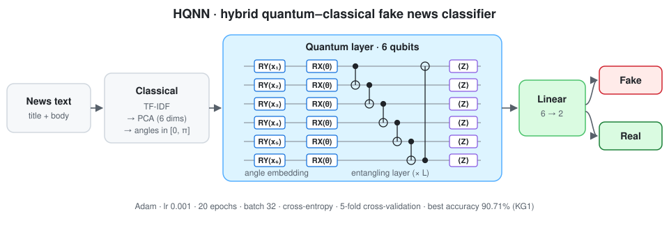

<div align="center">

# Fake News Detection with a Hybrid Quantum Neural Network (HQNN)
### Revolutionizing Fake News Detection: A Quantum Machine Learning Paradigm

[](https://ieeexplore.ieee.org/abstract/document/10944642)
[](https://doi.org/10.1109/CISS64860.2025.10944642)
[](#how-the-quantum-layer-works)
[](#installation)
[](LICENSE)
[](https://github.com/marif561/IEEE_Fake_News_Detection/actions/workflows/tests.yml)

Code and results for **"Revolutionizing Fake News Detection: A Quantum Machine Learning Paradigm"**, *2025 59th Annual Conference on Information Sciences and Systems (CISS)*, IEEE.

Ainaz Jamshidi (University of Maryland, Baltimore County) · **Muhammad Arif** (Colorado State University Pueblo)

</div>

---

## About the paper

Fake news spreads faster than ever through social media and online outlets, and it influences public opinion, democratic processes and global stability. Classical machine learning and deep learning have been studied widely for detecting it, but **quantum machine learning (QML)** has barely been explored for this task. This paper proposes a **Hybrid Quantum Neural Network (HQNN)** that labels news articles as **fake** or **real**. Classical feature extraction (TF-IDF and PCA) compresses each article into six numbers. These are encoded into a **6-qubit parameterised quantum circuit** with angle embedding and trainable entangling layers, and a classical fully connected layer makes the final decision from the qubits' measurements. Tested with 5-fold cross-validation on three open datasets, the HQNN reaches up to **90.71% accuracy**. This shows that hybrid quantum–classical models are a promising direction for fake news detection.

<p align="center">
  
</p>

## Datasets

| ID | Source | Fake | Real | Total |
|---|---|---:|---:|---:|
| **KG1** | Kaggle | 23,481 | 21,417 | 44,898 |
| **KG2** | Kaggle | 3,164 | 3,171 | 6,335 |
| **HF** | Hugging Face: [ErfanMoosaviMonazzah/fake-news-detection-dataset-English](https://huggingface.co/datasets/ErfanMoosaviMonazzah/fake-news-detection-dataset-English) | 15,478 | 14,522 | 30,000 |

All three are close to balanced between real and fake. The paper cites KG1 as Chaudhary's *Detecting fake news dataset* and KG2 as Bisaillon's *Fake and real news dataset*. The class counts suggest the two citations may be swapped: 23,481 / 21,417 is the size of the *Fake.csv* / *True.csv* "Fake and real news" dataset. The loaders here accept either layout. See [`data/README.md`](data/README.md).

## Method

| Stage | Details |
|---|---|
| Features | **TF-IDF** → **PCA** to 6 components, one per qubit |
| Embedding | **Angle embedding**: each feature xᵢ rotates qubit i around Y, U(xᵢ) = R_Y(xᵢ) = exp(−i xᵢ σ_Y / 2) |
| Entanglement | Trainable rotations, then **CNOT** gates coupling neighbouring qubits |
| Read-out | Expectation value **⟨Zᵢ⟩ ∈ [−1, 1]** of each of the 6 qubits |
| Classifier | **Fully connected layer, 6 → 2**, softmax → fake / real |
| Training | **Adam**, learning rate **0.001**, **20 epochs**, batch size **32**, cross-entropy loss |
| Evaluation | **5-fold cross-validation**: accuracy, precision, recall, F1 (mean ± std) |

## Results

Average over 5 folds ± standard deviation (Table I):

| Dataset | Accuracy | Precision | Recall | F1 |
|---|:-:|:-:|:-:|:-:|
| **KG1** | **90.71 ± 0.20** | 89.30 ± 0.00 | **91.49 ± 0.00** | **90.37 ± 0.00** |
| **KG2** | 78.75 ± 1.65 | 80.24 ± 0.01 | 76.36 ± 0.02 | 78.24 ± 0.01 |
| **HF** | 89.03 ± 0.49 | 87.59 ± 0.01 | 90.16 ± 0.01 | 88.83 ± 0.00 |

Test accuracy rises steadily during training and levels off on all three datasets. KG1 and HF reach about 89–91%. KG2 is the hardest, at about 79%, which the paper links to its greater complexity and variability. It is also by far the smallest dataset. The per-epoch curves (paper Fig. 2) are written to `results.json` for every run.

## How the quantum layer works

On *n* = 6 qubits, starting from |0…0⟩:

```
RY(x₁) ─ RX(θ₁) ─●──────────────────X─ ⟨Z₁⟩
RY(x₂) ─ RX(θ₂) ─X──●───────────────│─ ⟨Z₂⟩
RY(x₃) ─ RX(θ₃) ────X──●────────────│─ ⟨Z₃⟩      (entangling block repeated L times)
RY(x₄) ─ RX(θ₄) ───────X──●─────────│─ ⟨Z₄⟩
RY(x₅) ─ RX(θ₅) ──────────X──●──────│─ ⟨Z₅⟩
RY(x₆) ─ RX(θ₆) ─────────────X──────●─ ⟨Z₆⟩
```

The repository includes two back-ends for the same circuit:

- **`--backend pennylane`**: PennyLane `AngleEmbedding` + `BasicEntanglerLayers`, wrapped as a PyTorch layer.
- **`--backend torch`** (default): a small, exact, differentiable state-vector simulator written in PyTorch. It's fast for 6 qubits and needs no extra dependency.

The tests check that both give the same expectation values, and that the simulator matches analytic results: ⟨Z⟩ = cos x after RY(x), and ⟨Z₂⟩ = cos x₁ · cos x₂ after a CNOT.

## Repository structure

```
.
├── data/                    # Data guide + small invented sample
├── docs/figures/            # HQNN architecture diagram
├── results/                 # Table I, dataset sizes, hyperparameters (CSV)
├── scripts/run_all.sh       # 5-fold CV on KG1, KG2 and HF
├── tests/                   # Circuit-correctness + end-to-end tests (CI on every push)
└── src/hqnn/
    ├── data.py              # Two-file (Fake.csv / True.csv) or labelled-file loaders
    ├── features.py          # TF-IDF → PCA(6) → [0, π] angle scaling
    ├── quantum.py           # Quantum layer (PennyLane or PyTorch simulator) + HQNN model
    └── train.py             # 5-fold cross-validation, metrics, learning curves, baselines
```

## Installation

```bash
git clone https://github.com/marif561/IEEE_Fake_News_Detection.git
cd IEEE_Fake_News_Detection
python -m venv .venv && source .venv/bin/activate
pip install -e ".[pennylane]"
```

## Usage

```bash
# KG1-style data: one file of fake and one of real articles
python -m hqnn.train --fake data/kg1/Fake.csv --real data/kg1/True.csv --name KG1

# Single labelled file (labels FAKE/REAL, fake/real or 1/0)
python -m hqnn.train --data data/kg2/fake_or_real_news.csv --label-col label --name KG2

# Use PennyLane instead of the built-in simulator, and add classical reference models
python -m hqnn.train --data data/hf/train.csv --name HF --backend pennylane --baselines

# All three datasets
bash scripts/run_all.sh data
```

Each run writes `outputs/<name>/results.json` with mean ± std metrics, the per-fold scores and per-epoch test-accuracy curves. `--baselines` adds logistic regression on the same six PCA features and on the full TF-IDF matrix. These classical reference points are **not** in the paper, but they help show what the quantum layer contributes.

> **Note.** `src/` is a clean, tested re-implementation of the HQNN described in the paper. A few settings aren't stated in the paper: the number of entangling layers (default 2), the rotation inside the entangling layers (RX, the PennyLane default), how PCA outputs are scaled to angles (min-max to [0, π]) and the TF-IDF vocabulary size (5,000). They are listed in [`results/hyperparameters.csv`](results/hyperparameters.csv) and can be changed from the command line. Everything runs on a classical simulator. No quantum hardware is needed.

## Citation

```bibtex
@inproceedings{jamshidi2025quantum,
  title     = {Revolutionizing Fake News Detection: A Quantum Machine Learning Paradigm},
  author    = {Jamshidi, Ainaz and Arif, Muhammad},
  booktitle = {2025 59th Annual Conference on Information Sciences and Systems (CISS)},
  publisher = {IEEE},
  year      = {2025},
  doi       = {10.1109/CISS64860.2025.10944642}
}
```

## License

Code is released under the [MIT License](LICENSE). The datasets are subject to their own licences on Kaggle and Hugging Face.
